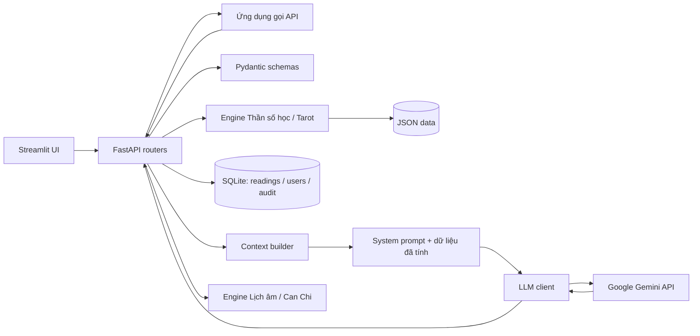

# OmniDivination Engine

Backend API cho các phép tính Thần số học, rút bài Tarot và diễn giải kết quả
bằng Gemini. Các phép tính cốt lõi chạy trong engine Python; dịch vụ LLM chỉ
nhận ngữ cảnh đã dựng từ kết quả, không nhận họ tên hay ngày sinh.

> Đây là dự án đang phát triển. Nội dung huyền học chỉ phục vụ giải trí và tự
> suy ngẫm, không phải dự đoán tương lai được khoa học xác nhận hay tư vấn
> chuyên môn.

## Mục lục

- [Tổng quan](#tổng-quan)
- [Tính năng và trạng thái](#tính-năng-và-trạng-thái)
- [Công nghệ](#công-nghệ)
- [Kiến trúc](#kiến-trúc)
- [Cấu trúc dự án](#cấu-trúc-dự-án)
- [Cài đặt và chạy](#cài-đặt-và-chạy)
- [Deploy bằng Docker và Render](#deploy-bằng-docker-và-render)
- [Cấu hình môi trường](#cấu-hình-môi-trường)
- [Sử dụng API](#sử-dụng-api)
- [Roadmap](#roadmap)
- [Kiểm thử](#kiểm-thử)
- [Bảo mật và quyền riêng tư](#bảo-mật-và-quyền-riêng-tư)
- [Tuyên bố miễn trừ trách nhiệm](#tuyên-bố-miễn-trừ-trách-nhiệm)
- [Đóng góp](#đóng-góp)
- [Tác giả và giấy phép](#tác-giả-và-giấy-phép)

## Tổng quan

OmniDivination Engine cung cấp API backend cho:

- Tính các chỉ số Thần số học từ ngày sinh và, tùy chọn, họ tên.
- Rút các lá trong bộ Tarot 78 lá, có phân biệt xuôi/ngược.
- Tạo diễn giải tiếng Việt qua Gemini dựa trên số liệu và từ khóa đã tính.

Mục tiêu hiện tại là tách phần tính toán xác định khỏi phần diễn giải sinh bởi
AI, để kết quả số và dữ liệu lá bài có thể được kiểm thử độc lập. Đối tượng
hướng tới là người đang tìm hiểu Thần số học/Tarot và nhà phát triển muốn thử
một backend Python có tích hợp LLM.

**Phạm vi hiện tại:** backend API có SQLite persistence cho lịch sử theo bearer
token ẩn danh và UI cơ bản bằng Streamlit. Chưa có đăng nhập tài khoản.

## Tính năng và trạng thái

| Tính năng | Trạng thái | Ghi chú |
|---|---|---|
| Số chủ đạo và Năm cá nhân | Hoàn thành | Engine thuần Python; ngày, tháng, năm được rút gọn riêng khi tính Số chủ đạo. |
| Chỉ số Linh hồn và Sức mạnh/Biểu đạt | Hoàn thành | Chuẩn hóa tên tiếng Việt có dấu; quy ước dự án xem chữ Y là nguyên âm. |
| Rút và tra cứu Tarot | Hoàn thành | Bộ bài 78 lá; rút tối đa 10 lá khác nhau mỗi lần. |
| API tính toán không dùng AI | Hoàn thành | Endpoint `/numerology` và `/tarot`. |
| Diễn giải Thần số học và Tarot qua Gemini | Đã tích hợp | Có system prompt, ngữ cảnh từ dữ liệu engine, disclaimer và xử lý lỗi dịch vụ. |
| Kiểm tra đầu vào và dữ liệu riêng tư | Hoàn thành ở mức hiện tại | Có test validation và xác nhận họ tên/ngày sinh không được đưa vào prompt diễn giải. |
| SQLite và lịch sử readings | Hoàn thành | Lưu kết quả theo bearer token ẩn danh; không lưu ngày sinh/họ tên. |
| Lịch Âm Việt Nam và Can Chi | Hoàn thành | Engine thuần theo thuật toán thiên văn Hồ Ngọc Đức, múi giờ UTC+7; giờ sinh tùy chọn. |
| Giao diện Streamlit | Bản cơ bản | Form Thần số học, Tarot, Lịch âm/Can Chi và xem/xóa lịch sử. |
| Tài khoản đăng nhập | Chưa triển khai | Lịch sử truy cập bằng token bearer; không có khôi phục danh tính/token. |

Các phép tính có quy ước riêng của dự án; chúng không phải đánh giá khoa học hay
chẩn đoán về người dùng.

## Công nghệ

| Thành phần | Công nghệ đã xác minh |
|---|---|
| Ngôn ngữ | Python (cú pháp dự án yêu cầu Python 3.10 trở lên; môi trường kiểm thử hiện tại dùng Python 3.14.5). |
| Backend/API | FastAPI `0.162.0`, Uvicorn `0.54.0`. |
| Validation/schema | Pydantic `2.14.1`. |
| LLM | Google Gemini qua `google-genai` `2.34.0`; model mặc định là `gemini-3.5-flash`, có thể đổi bằng biến môi trường. |
| HTTP và cấu hình | `httpx` `0.28.1`, `python-dotenv` `1.2.4`. |
| Kiểm thử | pytest `9.2.0`, FastAPI `TestClient`. |
| Persistence | SQLite qua thư viện chuẩn `sqlite3`; file DB mặc định trong `data/`. |
| Frontend | Streamlit `1.66.1` (dependency tùy chọn trong `requirements-ui.txt`). |
| Lưu trữ dữ liệu tĩnh | JSON cho bộ bài Tarot và từ khóa Thần số học. |

Dependency backend được ghim trong [`requirements.txt`](requirements.txt);
dependency Streamlit tùy chọn được ghim riêng trong
[`requirements-ui.txt`](requirements-ui.txt).

## Kiến trúc



Trong luồng diễn giải Thần số học, router nhận ngày sinh và họ tên để validation
và tính toán. Context builder chỉ nhận các con số, năm và chủ đề; vì vậy họ tên
và ngày sinh không được đưa vào prompt gửi Gemini. Luồng Tarot gửi tên lá, chiều
bài, từ khóa và ghi chú an toàn nếu có.

LLM client đặt timeout kết nối 10 giây và timeout request 30 giây, đồng thời tắt
retry tự động cho lời gọi Interactions. Bộ diễn giải giới hạn tối đa hai lần gọi
LLM cho một reading (lần đầu và một lần thử lại). Các endpoint tính toán được
giới hạn 60 request/phút/IP; endpoint diễn giải được giới hạn 10 request/phút/IP.
Prompt có hướng dẫn an toàn, nhưng prompt không thay thế các biện pháp kiểm soát
đầu ra bằng code.

## Cấu trúc dự án

```text
.
├── app/
│   ├── ai/
│   │   ├── __init__.py
│   │   ├── check.py
│   │   ├── client.py
│   │   ├── context_builder.py
│   │   ├── interpreter.py
│   │   ├── list_models.py
│   │   ├── model_probe.py
│   │   ├── prompts.py
│   │   └── rest_probe.py
│   ├── api/
│   │   ├── __init__.py
│   │   └── v1/
│   │       ├── __init__.py
│   │       ├── llm_errors.py
│   │       ├── lunar.py
│   │       ├── numerology.py
│   │       ├── reading_storage.py
│   │       ├── readings.py
│   │       └── tarot.py
│   ├── data/
│   │   ├── numerology_meanings.json
│   │   └── tarot_cards.json
│   ├── db/
│   │   ├── __init__.py
│   │   └── database.py
│   ├── engine/
│   │   ├── can_chi.py
│   │   ├── lunar_calendar.py
│   │   ├── name_numerology.py
│   │   ├── numerology.py
│   │   └── tarot.py
│   ├── request_middleware.py
│   ├── safety/
│   │   ├── __init__.py
│   │   └── output_filter.py
│   ├── schemas/
│   │   ├── __init__.py
│   │   ├── lunar.py
│   │   ├── numerology.py
│   │   └── tarot.py
│   ├── __init__.py
│   ├── config.py
│   ├── main.py
│   └── rate_limit.py
├── tests/
│   ├── __init__.py
│   ├── test_api.py
│   ├── test_config.py
│   ├── test_context_builder.py
│   ├── test_health.py
│   ├── test_interpret_api.py
│   ├── test_can_chi.py
│   ├── test_lunar_api.py
│   ├── test_lunar_calendar.py
│   ├── test_interpreter.py
│   ├── test_name_numerology.py
│   ├── test_numerology.py
│   ├── test_output_filter.py
│   ├── test_reading_history.py
│   └── test_tarot.py
├── ui/
│   └── streamlit_app.py
├── .env.example
├── .gitignore
├── README.md
├── requirements-ui.txt
└── requirements.txt
```

- `app/engine/`: tính Thần số học, đổi dương lịch sang âm lịch Việt Nam, tính
  Can Chi, chuẩn hóa tên, rút bài và tra bộ bài; không gọi mạng hay LLM.
- `app/data/`: dữ liệu JSON cho từ khóa số và 78 lá Tarot.
- `app/schemas/`: hợp đồng request/response và validation Pydantic.
- `app/api/v1/`: các route API và chuyển lỗi LLM thành HTTP errors. Route lịch
  âm không gọi LLM.
- `app/api/v1/readings.py`: cấp reading token, xem lịch sử theo token và xóa từng reading.
- `app/db/`: SQLite persistence cho phiên owner ẩn danh, readings và audit events.
- `data/omnidivination.db`: database mặc định được tạo tự động, không commit vào Git.
- `app/rate_limit.py`: giới hạn request theo IP cho các endpoint tính toán và diễn giải.
- `app/request_middleware.py`: giới hạn request body 16 KiB, tạo `X-Request-ID` và ghi audit JSON cho endpoint diễn giải; log không chứa prompt hay dữ liệu cá nhân.
- `app/safety/`: kiểm tra dữ liệu AI trước khi trả kết quả; request schema từ chối các trường không khai báo thay vì nhận câu hỏi tự do.
- `app/ai/`: dựng ngữ cảnh, system prompt, tích hợp Gemini và công cụ kiểm tra
  kết nối/model.
- `ui/streamlit_app.py`: giao diện Streamlit cho Thần số học, Tarot, Lịch âm /
  Can Chi và quản lý lịch sử.
- `tests/`: unit test và API test.

## Cài đặt và chạy

### Yêu cầu

- Windows và PowerShell (các lệnh bên dưới dùng PowerShell).
- Python 3.10 trở lên; phiên bản dùng để kiểm thử trong workspace là Python
  3.14.5.
- Kết nối Internet và Gemini API key chỉ cần cho các endpoint diễn giải và các
  công cụ kiểm tra Gemini.

### Cài dependencies

```powershell
git clone https://github.com/Buildhzay/OmniDivination-Engine.git
Set-Location .\OmniDivination-Engine

py -m venv .venv
.\.venv\Scripts\Activate.ps1
python -m pip install --upgrade pip
pip install -r requirements.txt
```

Để cài giao diện Streamlit (tùy chọn):

```powershell
pip install -r requirements-ui.txt
```

Nếu PowerShell chặn kích hoạt virtual environment, có thể gọi Python trong venv
trực tiếp, ví dụ:

```powershell
.\.venv\Scripts\python.exe -m pip install -r requirements.txt
```

SQLite được khởi tạo tự động khi tạo session, lưu reading hoặc ghi audit event.
File mặc định là `data/omnidivination.db` tại thư mục dự án. Có thể đặt đường
dẫn khác bằng `OMNIDIVINATION_DB_PATH`.

### Cấu hình Gemini

Tạo `.env` từ mẫu rồi mở file trong VS Code để điền key:

```powershell
Copy-Item .env.example .env
code .env
```

Đặt `GEMINI_API_KEY` thành key của bạn. Không dán key vào source code, README,
issue công khai hoặc chat. Xem thêm [Cấu hình môi trường](#cấu-hình-môi-trường).

### Chạy API

```powershell
uvicorn app.main:app --reload
```

Mặc định Uvicorn phục vụ tại `http://127.0.0.1:8000`:

- Swagger UI: <http://127.0.0.1:8000/docs>
- ReDoc: <http://127.0.0.1:8000/redoc>
- OpenAPI JSON: <http://127.0.0.1:8000/openapi.json>

Kiểm tra nhanh:

```powershell
Invoke-RestMethod -Method Get -Uri http://127.0.0.1:8000/health
```

### Chạy Streamlit UI

Giữ backend đang chạy và mở terminal thứ hai tại thư mục dự án:

```powershell
$env:OMNIDIVINATION_API_URL = "http://127.0.0.1:8000"
streamlit run ui/streamlit_app.py
```

UI có thể đổi backend URL trong sidebar. Reading Token cho phép lưu, xem và xóa
lịch sử; nếu mất token, lịch sử tương ứng không thể khôi phục.

### Kiểm tra kết nối LLM

Lệnh sau gửi một prompt ngắn tới Gemini và có thể tiêu thụ hạn mức API:

```powershell
python -m app.ai.check
```

Các công cụ chẩn đoán khác:

```powershell
python -m app.ai.list_models
python -m app.ai.model_probe
python -m app.ai.rest_probe
```

`list_models` gọi endpoint liệt kê model. `model_probe` gửi yêu cầu sinh văn bản
tới nhiều model ứng viên; `rest_probe` thử sinh văn bản qua REST trực tiếp và
có thể chờ tối đa 60 giây. Các probe sinh văn bản có thể tiêu thụ hạn mức; chỉ
chạy khi bạn chủ động muốn kiểm tra.

## Deploy bằng Docker và Render

Repository có [Dockerfile](Dockerfile) cho FastAPI backend. Ảnh dùng Python
3.14, chạy Uvicorn trên `0.0.0.0` và đọc cổng từ biến `PORT` (mặc định
`10000`). `.dockerignore` loại `.env`, Git metadata, virtualenv và database khỏi
build context. Không đưa key thật vào image hoặc repository.

### Chạy Docker cục bộ

Từ PowerShell tại thư mục dự án:

```powershell
docker build -t omnidivination-api .
docker run --rm -p 10000:10000 `
  --env-file .env `
  -e PORT=10000 `
  -e OMNIDIVINATION_DB_PATH=/var/data/omnidivination.db `
  -v "${PWD}\data:/var/data" `
  omnidivination-api
```

Sau khi chạy, kiểm tra `http://localhost:10000/health` và
`http://localhost:10000/docs`. Trước đó tạo `.env` từ `.env.example`, điền key
nếu cần gọi Gemini, và không đưa file này vào source control.

### Deploy FastAPI lên Render

1. Đẩy repository lên GitHub sau khi kiểm tra `.env` và dữ liệu riêng tư không
   nằm trong Git index. `.gitignore` không tự bỏ theo dõi file đã được commit.
2. Trong Render, tạo **New → Web Service**, kết nối repository và chọn runtime
   **Docker** để Render build từ `Dockerfile` ở root.
3. Đặt health check path là `/health`.
4. Thêm biến môi trường:

   | Key | Value |
   |---|---|
   | `GEMINI_API_KEY` | Secret key tạo trong Google AI Studio |
   | `LLM_MODEL` | `gemini-3.5-flash` |
   | `APP_ENV` | `production` |
   | `OMNIDIVINATION_DB_PATH` | `/var/data/omnidivination.db` |

5. Để giữ Reading sessions, readings và audit events sau redeploy, gắn
   **Persistent Disk** vào `/var/data`. Filesystem không được gắn persistent
   disk có thể bị làm mới khi service restart/redeploy. Xác nhận chính sách
   disk và chi phí hiện hành của Render trước khi bật.
6. Deploy xong, kiểm tra `https://<service>.onrender.com/health` trả về
   `{"status":"ok"}` và mở `/docs`. Không cần thiết lập CORS cho cách dùng
   Streamlit server-side hiện tại.

Giữ một instance backend khi dùng SQLite và rate limit trong memory. SQLite
không tự chia sẻ dữ liệu giữa nhiều instance; bộ đếm rate limit cũng không được
đồng bộ giữa nhiều worker. Nếu cần scale ngang, nhiều worker, hoặc độ sẵn sàng
cao, hãy chuyển persistence sang PostgreSQL và rate limit sang storage dùng
chung trước khi tăng số instance.

### Deploy Streamlit UI (tùy chọn)

Tạo một Web Service riêng từ cùng repository, chọn runtime Python, dùng
`pip install -r requirements-ui.txt` làm build command và lệnh sau làm start
command:

```sh
streamlit run ui/streamlit_app.py --server.port "$PORT" --server.address 0.0.0.0
```

Đặt biến `OMNIDIVINATION_API_URL` thành URL HTTPS public của backend, ví dụ
`https://<api-service>.onrender.com`. Đặt secret Gemini ở backend, không ở UI
service. Kiểm tra backend vẫn truy cập được endpoint qua URL public. Với service
UI và API tách riêng trên hai origin khác nhau, giao diện Streamlit gọi backend
server-side; nếu sau này thêm trình duyệt gọi API trực tiếp thì cần cấu hình
CORS theo đúng domain, không mở wildcard theo mặc định.

## Cấu hình môi trường

Tệp mẫu tại [`.env.example`](.env.example):

| Biến | Bắt buộc | Mặc định | Mô tả |
|---|---:|---|---|
| `GEMINI_API_KEY` | Cho chức năng diễn giải | Không có | Khóa truy cập Gemini. Không ghi key thật vào `.env.example`. |
| `LLM_MODEL` | Không | `gemini-3.5-flash` | Model Gemini dùng cho lời gọi diễn giải. |
| `APP_ENV` | Không | `development` | Được đọc vào settings; hiện chưa dùng để thay đổi hành vi ứng dụng. |
| `OMNIDIVINATION_DB_PATH` | Không | `data/omnidivination.db` | Đường dẫn file SQLite; thư mục cha được tạo tự động. |
| `OMNIDIVINATION_API_URL` | Chỉ UI | `http://127.0.0.1:8000` | URL backend mà Streamlit gọi; có thể ghi đè trong sidebar. |

`app/config.py` nạp `.env` qua `python-dotenv`. Khi thiếu key, client báo lỗi cấu
hình; API diễn giải trả HTTP `503`.

Trên Render, đặt `OMNIDIVINATION_DB_PATH=/var/data/omnidivination.db` và mount
persistent disk tại `/var/data`; giá trị đó khác với đường dẫn mặc định dùng
khi phát triển cục bộ.

`.gitignore` có quy tắc `.env`, nhưng quy tắc ignore không tự bỏ theo dõi một
tệp đã được Git track. Trước khi chia sẻ repository, xác nhận `.env` không nằm
trong Git index. Nếu key đã từng được commit hoặc đẩy lên remote, hãy thu hồi
key đó và tạo key mới; chỉ xóa tệp khỏi commit mới không xóa được lịch sử cũ.

## Sử dụng API

Các endpoint nghiệp vụ dùng prefix `/api/v1/divination`. Request/response được
tra cứu đầy đủ tại `/docs`.

### `GET /health`

Kiểm tra tiến trình API:

```json
{"status": "ok"}
```

### `POST /api/v1/divination/numerology`

Tính các chỉ số mà không gọi LLM.

Request:

```json
{
  "dob": "2006-07-03",
  "full_name": "Nguyễn Văn A",
  "target_year": 2026
}
```

`dob` bắt buộc, định dạng `YYYY-MM-DD`, từ năm 1900 trở đi và không được là ngày
tương lai. `full_name` tùy chọn, tối đa 100 ký tự. `target_year` tùy chọn, từ
1900 đến 2200; nếu bỏ qua, dùng năm hiện tại.

Response mẫu:

```json
{
  "life_path": 9,
  "personal_year": 2,
  "target_year": 2026,
  "soul_urge": 8,
  "expression": 7
}
```

### `POST /api/v1/divination/numerology/interpret`

Nhận các trường của request Thần số học, thêm `topic` tùy chọn (`general` hoặc
`career`), rồi yêu cầu Gemini tạo diễn giải.

Response gồm các trường số như endpoint tính toán, cùng:

```json
{
  "interpretation": "Nội dung do Gemini tạo; có thể thay đổi theo từng lần gọi.",
  "disclaimer": "Nội dung chỉ mang tính giải trí và gợi mở tự suy ngẫm..."
}
```

### `POST /api/v1/divination/tarot`

Rút bài mà không gọi LLM. Request có `count` tùy chọn từ 1 đến 10, mặc định là
3. Ví dụ dưới đây rút một lá:

```json
{"count": 1}
```

Response gồm seed và danh sách lá rút:

```json
{
  "seed": 123456789,
  "cards": [
    {
      "position": 1,
      "card_id": 1,
      "name_vi": "Chàng Ngốc",
      "name_en": "The Fool",
      "is_reversed": false,
      "keywords": ["khởi đầu mới", "tự do", "dám thử"],
      "safety_note": null
    }
  ]
}
```

Seed thực tế được tạo ngẫu nhiên và trả lại trong response. API không nhận seed
tùy chọn từ người gọi.

### `POST /api/v1/divination/tarot/interpret`

Nhận `count` (1–10) và `topic` (`general` hoặc `career`), rút bài rồi gửi dữ
liệu lá bài cần thiết cho Gemini. Response gồm `seed`, `cards`,
`interpretation` và `disclaimer`.

### `POST /api/v1/divination/lunar`

Đổi ngày dương lịch sang lịch Âm Việt Nam và tính Can Chi, hoàn toàn không gọi
LLM. Engine dùng thuật toán thiên văn Hồ Ngọc Đức với múi giờ UTC+7; phạm vi
được hỗ trợ là năm 1800–2199. API hiện giới hạn ngày sinh từ năm 1900 đến ngày
hiện tại. `birth_time` không bắt buộc và nếu có phải là giờ địa phương Việt Nam
không kèm múi giờ. Ngày Can Chi chuyển sang ngày mới lúc 00:00 dân sự.

Request:

```json
{
  "dob": "2006-07-03",
  "birth_time": "15:30"
}
```

Response:

```json
{
  "solar_date": "2006-07-03",
  "lunar_date": {
    "day": 9,
    "month": 6,
    "year": 2006,
    "is_leap_month": false
  },
  "can_chi": {
    "year": "Bính Tuất",
    "month": "Ất Mùi",
    "day": "Quý Tỵ",
    "hour": "Canh Thân"
  }
}
```

`hour` là `null` nếu không gửi giờ sinh. Năm Can Chi đổi theo Tết âm lịch;
tháng Can Chi dựa trên tháng âm lịch. Bộ kiểm thử có các ngày mẫu, mốc Tết và
ranh giới tháng nhuận năm 2023.

### Reading history

Tạo phiên ẩn danh để nhận bearer token:

```http
POST /api/v1/readings/session
```

Token chỉ trả về lúc tạo. Database lưu hash của token, không lưu token gốc.
Gửi token trong `X-Reading-Token` khi gọi endpoint tính toán/diễn giải để lưu
kết quả, hoặc khi xem lịch sử:

```http
GET /api/v1/readings/history?limit=50&offset=0
X-Reading-Token: <reading_token>
```

History trả danh sách `{id, module, created_at, result}`. `limit` từ 1 đến
100, `offset` không âm. Có thể xóa một reading thuộc phiên bằng:

```http
DELETE /api/v1/readings/history/{reading_id}
X-Reading-Token: <reading_token>
```

Readings chỉ lưu kết quả đã tính/diễn giải; không lưu họ tên. Với module lịch
âm, phản hồi trực tiếp có `solar_date` nhưng trường này được loại khỏi bản lưu
lịch sử. Lịch sử vẫn chứa ngày âm và Can Chi đã tính. Lịch sử được giữ vô thời
hạn cho tới khi từng mục bị xóa. Phiên ẩn danh không có khôi phục token hoặc
xóa toàn bộ tài khoản.

### Mã trạng thái thường gặp

| HTTP | Ý nghĩa |
|---:|---|
| `200` | Request hợp lệ và xử lý thành công. |
| `201` | Tạo phiên reading token thành công. |
| `413` | Request body vượt quá 16 KiB. |
| `422` | Payload không đúng schema, ngày sinh không hợp lệ hoặc chủ đề/số lá ngoài phạm vi. |
| `401` | Reading token thiếu hoặc không hợp lệ khi truy cập history. |
| `404` | Reading không tồn tại hoặc không thuộc token hiện tại. |
| `204` | Xóa reading thành công. |
| `502` | Dịch vụ LLM tạm thời không phản hồi hoặc gặp lỗi dịch vụ. |
| `503` | Chưa cấu hình dịch vụ diễn giải (thiếu `GEMINI_API_KEY`). |
| `429` | Đã vượt giới hạn request theo IP: 60/phút cho endpoint tính toán, 10/phút cho endpoint diễn giải. |

Mỗi phản hồi HTTP có header `X-Request-ID` do máy chủ tạo để tiện tra cứu log.
Các endpoint diễn giải ghi audit JSON và lưu trong bảng SQLite `audit_events`,
gồm timestamp, request ID, module, endpoint, trạng thái accepted/rejected và lý
do tổng quát. Audit log không ghi payload, prompt, họ tên, ngày sinh hoặc nội
dung trả lời của Gemini.

Rate limit hiện dùng bộ nhớ trong tiến trình, được tính riêng theo endpoint và
địa chỉ IP: tạo session 5/phút, history 60/phút, endpoint tính toán 60/phút và
endpoint diễn giải 10/phút. Bộ đếm được đặt lại khi tiến trình khởi động lại;
nhiều worker hoặc nhiều máy chủ không chia sẻ bộ đếm. Khi triển khai sau reverse
proxy, cần cấu hình proxy đáng tin cậy để ứng dụng nhận đúng IP client; không
nên tin header IP do client tùy ý gửi.

## Roadmap

Không tìm thấy roadmap chính thức hoặc danh sách issue trong tài liệu hiện có.
Các mục Planned dưới đây là hướng mở rộng có thể cân nhắc, không phải cam kết
hay tính năng đã triển khai.

### Completed

- [x] Engine Thần số học, gồm tính theo tên có dấu tiếng Việt.
- [x] Engine Tarot và dữ liệu bộ bài 78 lá.
- [x] API tính toán và API diễn giải Thần số học/Tarot.
- [x] Tích hợp Gemini, system prompt và disclaimer.
- [x] Kiểm thử validation, rút bài, tính toán và bảo vệ dữ liệu cá nhân trong prompt.
- [x] Rate limit theo IP, request ID và audit log không chứa payload cá nhân.
- [x] SQLite persistence, History API theo bearer token và giao diện Streamlit cơ bản.
- [x] Chuyển đổi lịch Âm Việt Nam, Can Chi năm/tháng/ngày/giờ và API/UI tương ứng.

### In Progress

- [ ] Chưa có hạng mục đang phát triển nào được xác định trong mã nguồn/tài liệu đã kiểm tra.

### Planned — đề xuất, chưa triển khai

- [ ] Module Tử Vi, gồm an sao và luận giải.
- [ ] Phân tích tương hợp/tình duyên.
- [ ] Chatbot có hội thoại nhiều lượt.
- [ ] Đăng nhập tài khoản và khôi phục quyền truy cập lịch sử.
- [ ] Hỗ trợ PostgreSQL cho môi trường triển khai nhiều instance.

## Kiểm thử

Chạy toàn bộ suite từ thư mục gốc dự án:

```powershell
python -m pytest -q
```

Suite kiểm tra engine Thần số học, lịch âm và Can Chi (gồm mốc tháng nhuận,
Tết âm lịch và giờ Tý), chuẩn hóa tên, bộ bài, endpoint tính toán/diễn giải,
validation, xử lý lỗi LLM, rate limiting, request ID và audit log. History API
được kiểm tra với token, phân quyền chủ sở hữu, lưu/xóa reading, migration
schema SQLite và không lưu họ tên/ngày sinh dương lịch trong bản ghi.

Có một cảnh báo `StarletteDeprecationWarning` liên quan đến `TestClient` và
`httpx`; test hiện vẫn chạy thành công. Chưa có kiểm thử frontend, database,
load/performance hay kiểm thử an ninh triển khai thực tế.

## Bảo mật và quyền riêng tư

- Không commit API key. Dùng `.env` cục bộ; không đưa key thật vào code, log,
  ảnh chụp hoặc nội dung issue.
- Nếu key bị lộ, thu hồi key trong Google AI Studio và tạo key mới. Ignore một
  tệp không xóa dữ liệu đã được commit trong lịch sử Git.
- API nhận họ tên/ngày sinh ở backend để tính chỉ số; endpoint numerology không
  trả lại họ tên/ngày sinh và kiểm thử xác nhận chúng không được đưa vào prompt
  gửi LLM. Endpoint lịch âm trả lại `solar_date` theo hợp đồng API, nhưng không
  gửi dữ liệu này tới LLM.
- Khi có `X-Reading-Token`, database chỉ lưu kết quả đã tính, không lưu họ tên
  hoặc ngày sinh dương lịch; riêng kết quả lịch sử lịch âm bỏ trường
  `solar_date`. Token gốc không được lưu mà chỉ lưu SHA-256 hash. Token là bí
  mật truy cập lịch sử, không có cơ chế khôi phục.
- Schema từ chối các trường không khai báo; API hiện không nhận văn bản câu hỏi
  tự do. Tên có giới hạn 100 ký tự và số lá Tarot có giới hạn 1–10. Nếu bổ sung
  chatbot hoặc câu hỏi tự do, cần thiết kế input filtering và giới hạn độ dài
  riêng trước khi chuyển nội dung đó tới LLM. Middleware cũng giới hạn toàn bộ
  request body ở mức 16 KiB.
- Audit log cho endpoint diễn giải chỉ chứa metadata tối thiểu và lý do tổng
  quát; không ghi payload, prompt hay nội dung AI. Audit events được lưu trong
  SQLite vô thời hạn; cần bảo vệ file database và có chính sách sao lưu/xóa.
- Gemini vẫn nhận prompt có các chỉ số đã tính, chủ đề và dữ liệu Tarot liên
  quan. Hãy xem điều khoản và chính sách dữ liệu hiện hành của Google trước khi
  dùng với dữ liệu nhạy cảm.
- Chưa có xác thực tài khoản hay phân quyền theo danh tính thật. Rate limiting
  hiện dùng bộ nhớ trong tiến trình, chưa chia sẻ bộ đếm giữa nhiều worker/máy
  chủ và không thay thế các biện pháp bảo vệ khi triển khai công khai.
- Request ID được máy chủ tạo mới cho mỗi request; hiện không có distributed
  tracing.
- Khi triển khai ngoài máy cá nhân, dùng HTTPS và cấu hình secrets qua hệ thống
  quản lý secret của môi trường triển khai; không dùng `.env` chứa key trong
  repository.
- System prompt là hướng dẫn cho mô hình, không phải ranh giới bảo mật tuyệt
  đối. Không gửi thông tin nhạy cảm không cần thiết.

## Tuyên bố miễn trừ trách nhiệm

Thần số học, Tarot và các hình thức bói toán trong dự án chỉ mang tính tham khảo,
giải trí và gợi mở tự suy ngẫm. Đây không phải phương pháp dự đoán tương lai
được khoa học xác nhận, không phải chẩn đoán và không thay thế tư vấn y tế,
tài chính hoặc pháp lý. Không sử dụng kết quả để đưa ra quyết định quan trọng
thay cho chuyên gia phù hợp.

## Đóng góp

Repository hiện chưa có `CONTRIBUTING.md` hoặc quy trình đóng góp chính thức.
Nếu muốn đề xuất thay đổi:

1. Mở issue để mô tả vấn đề hoặc đề xuất trước khi triển khai thay đổi lớn.
2. Tạo nhánh riêng và giữ thay đổi tập trung.
3. Thêm/cập nhật test cho hành vi thay đổi.
4. Chạy `python -m pytest -q` trước khi gửi pull request.
5. Không đưa API key, dữ liệu cá nhân thật hoặc file `.env` vào commit.

## Tác giả và giấy phép

- Repository: [Buildhzay/OmniDivination-Engine](https://github.com/Buildhzay/OmniDivination-Engine).
- Tác giả: HoangdatHZ
- Giấy phép: repository hiện chưa có tệp `LICENSE`; quyền sử dụng/phân phối
  chưa được xác định. Hãy bổ sung giấy phép trước khi phát hành như một dự án
  open source.
