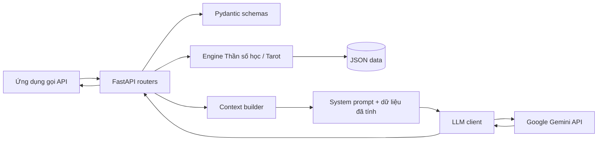

# OmniDivination Engine

Backend API cho các phép tính Thần số học, rút bài Tarot và diễn giải kết quả
bằng Gemini. Các phép tính cốt lõi chạy trong engine Python; dịch vụ LLM chỉ
nhận ngữ cảnh đã dựng từ kết quả, không nhận họ tên hay ngày sinh.

> Đây là dự án đang phát triển. Nội dung huyền học chỉ phục vụ giải trí và tự
> suy ngẫm, không phải dự đoán tương lai được khoa học xác nhận hay tư vấn
> chuyên môn.

## Mục lục

- [Tổng quan](#tổng-quan)
- [Tính năng và trạng thái](#tính-năng-và-trạng-thái)
- [Công nghệ](#công-nghệ)
- [Kiến trúc](#kiến-trúc)
- [Cấu trúc dự án](#cấu-trúc-dự-án)
- [Cài đặt và chạy](#cài-đặt-và-chạy)
- [Cấu hình môi trường](#cấu-hình-môi-trường)
- [Sử dụng API](#sử-dụng-api)
- [Roadmap](#roadmap)
- [Kiểm thử](#kiểm-thử)
- [Bảo mật và quyền riêng tư](#bảo-mật-và-quyền-riêng-tư)
- [Tuyên bố miễn trừ trách nhiệm](#tuyên-bố-miễn-trừ-trách-nhiệm)
- [Đóng góp](#đóng-góp)
- [Tác giả và giấy phép](#tác-giả-và-giấy-phép)

## Tổng quan

OmniDivination Engine cung cấp API backend cho:

- Tính các chỉ số Thần số học từ ngày sinh và, tùy chọn, họ tên.
- Rút các lá trong bộ Tarot 78 lá, có phân biệt xuôi/ngược.
- Tạo diễn giải tiếng Việt qua Gemini dựa trên số liệu và từ khóa đã tính.

Mục tiêu hiện tại là tách phần tính toán xác định khỏi phần diễn giải sinh bởi
AI, để kết quả số và dữ liệu lá bài có thể được kiểm thử độc lập. Đối tượng
hướng tới là người đang tìm hiểu Thần số học/Tarot và nhà phát triển muốn thử
một backend Python có tích hợp LLM.

**Phạm vi hiện tại:** đây là backend API; repository chưa có frontend, cơ sở
dữ liệu, đăng nhập người dùng hay lưu lịch sử xem.

## Tính năng và trạng thái

| Tính năng | Trạng thái | Ghi chú |
|---|---|---|
| Số chủ đạo và Năm cá nhân | Hoàn thành | Engine thuần Python; ngày, tháng, năm được rút gọn riêng khi tính Số chủ đạo. |
| Chỉ số Linh hồn và Sức mạnh/Biểu đạt | Hoàn thành | Chuẩn hóa tên tiếng Việt có dấu; quy ước dự án xem chữ Y là nguyên âm. |
| Rút và tra cứu Tarot | Hoàn thành | Bộ bài 78 lá; rút tối đa 10 lá khác nhau mỗi lần. |
| API tính toán không dùng AI | Hoàn thành | Endpoint `/numerology` và `/tarot`. |
| Diễn giải Thần số học và Tarot qua Gemini | Đã tích hợp | Có system prompt, ngữ cảnh từ dữ liệu engine, disclaimer và xử lý lỗi dịch vụ. |
| Kiểm tra đầu vào và dữ liệu riêng tư | Hoàn thành ở mức hiện tại | Có test validation và xác nhận họ tên/ngày sinh không được đưa vào prompt diễn giải. |
| Frontend, tài khoản và lưu lịch sử | Chưa triển khai | Không có trong mã nguồn hiện tại. |

Các phép tính có quy ước riêng của dự án; chúng không phải đánh giá khoa học hay
chẩn đoán về người dùng.

## Công nghệ

| Thành phần | Công nghệ đã xác minh |
|---|---|
| Ngôn ngữ | Python (cú pháp dự án yêu cầu Python 3.10 trở lên; môi trường kiểm thử hiện tại dùng Python 3.14.5). |
| Backend/API | FastAPI `0.162.0`, Uvicorn `0.54.0`. |
| Validation/schema | Pydantic `2.14.1`. |
| LLM | Google Gemini qua `google-genai` `2.34.0`; model mặc định là `gemini-3.5-flash`, có thể đổi bằng biến môi trường. |
| HTTP và cấu hình | `httpx` `0.28.1`, `python-dotenv` `1.2.4`. |
| Kiểm thử | pytest `9.2.0`, FastAPI `TestClient`. |
| Lưu trữ dữ liệu tĩnh | JSON cho bộ bài Tarot và từ khóa Thần số học. |
| Database / frontend | Chưa được sử dụng trong repository hiện tại. |

Các dependency đã ghim phiên bản trong [`requirements.txt`](requirements.txt).

## Kiến trúc



Trong luồng diễn giải Thần số học, router nhận ngày sinh và họ tên để validation
và tính toán. Context builder chỉ nhận các con số, năm và chủ đề; vì vậy họ tên
và ngày sinh không được đưa vào prompt gửi Gemini. Luồng Tarot gửi tên lá, chiều
bài, từ khóa và ghi chú an toàn nếu có.

LLM client đặt timeout kết nối 10 giây và timeout request 30 giây, đồng thời tắt
retry tự động cho lời gọi Interactions. Prompt có hướng dẫn an toàn, nhưng prompt
không thay thế các biện pháp kiểm soát đầu ra bằng code.

## Cấu trúc dự án

```text
.
├── app/
│   ├── ai/
│   │   ├── __init__.py
│   │   ├── check.py
│   │   ├── client.py
│   │   ├── context_builder.py
│   │   ├── interpreter.py
│   │   ├── list_models.py
│   │   ├── model_probe.py
│   │   ├── prompts.py
│   │   └── rest_probe.py
│   ├── api/
│   │   ├── __init__.py
│   │   └── v1/
│   │       ├── __init__.py
│   │       ├── llm_errors.py
│   │       ├── numerology.py
│   │       └── tarot.py
│   ├── data/
│   │   ├── numerology_meanings.json
│   │   └── tarot_cards.json
│   ├── engine/
│   │   ├── name_numerology.py
│   │   ├── numerology.py
│   │   └── tarot.py
│   ├── schemas/
│   │   ├── __init__.py
│   │   ├── numerology.py
│   │   └── tarot.py
│   ├── __init__.py
│   ├── config.py
│   └── main.py
├── tests/
│   ├── __init__.py
│   ├── test_api.py
│   ├── test_config.py
│   ├── test_context_builder.py
│   ├── test_health.py
│   ├── test_interpret_api.py
│   ├── test_interpreter.py
│   ├── test_name_numerology.py
│   ├── test_numerology.py
│   └── test_tarot.py
├── .env.example
├── .gitignore
├── README.md
└── requirements.txt
```

- `app/engine/`: tính Thần số học, chuẩn hóa tên, rút bài và tra bộ bài; không
  gọi mạng hay LLM.
- `app/data/`: dữ liệu JSON cho từ khóa số và 78 lá Tarot.
- `app/schemas/`: hợp đồng request/response và validation Pydantic.
- `app/api/v1/`: các route API và chuyển lỗi LLM thành HTTP errors.
- `app/ai/`: dựng ngữ cảnh, system prompt, tích hợp Gemini và công cụ kiểm tra
  kết nối/model.
- `tests/`: unit test và API test.

## Cài đặt và chạy

### Yêu cầu

- Windows và PowerShell (các lệnh bên dưới dùng PowerShell).
- Python 3.10 trở lên; phiên bản dùng để kiểm thử trong workspace là Python
  3.14.5.
- Kết nối Internet và Gemini API key chỉ cần cho các endpoint diễn giải và các
  công cụ kiểm tra Gemini.

### Cài dependencies

```powershell
git clone https://github.com/Buildhzay/OmniDivination-Engine.git
Set-Location .\OmniDivination-Engine

py -m venv .venv
.\.venv\Scripts\Activate.ps1
python -m pip install --upgrade pip
pip install -r requirements.txt
```

Nếu PowerShell chặn kích hoạt virtual environment, có thể gọi Python trong venv
trực tiếp, ví dụ:

```powershell
.\.venv\Scripts\python.exe -m pip install -r requirements.txt
```

Không cần khởi tạo database: dự án hiện dùng dữ liệu JSON và chưa tích hợp
database.

### Cấu hình Gemini

Tạo `.env` từ mẫu rồi mở file trong VS Code để điền key:

```powershell
Copy-Item .env.example .env
code .env
```

Đặt `GEMINI_API_KEY` thành key của bạn. Không dán key vào source code, README,
issue công khai hoặc chat. Xem thêm [Cấu hình môi trường](#cấu-hình-môi-trường).

### Chạy API

```powershell
uvicorn app.main:app --reload
```

Mặc định Uvicorn phục vụ tại `http://127.0.0.1:8000`:

- Swagger UI: <http://127.0.0.1:8000/docs>
- ReDoc: <http://127.0.0.1:8000/redoc>
- OpenAPI JSON: <http://127.0.0.1:8000/openapi.json>

Kiểm tra nhanh:

```powershell
Invoke-RestMethod -Method Get -Uri http://127.0.0.1:8000/health
```

### Kiểm tra kết nối LLM

Lệnh sau gửi một prompt ngắn tới Gemini và có thể tiêu thụ hạn mức API:

```powershell
python -m app.ai.check
```

Các công cụ chẩn đoán khác:

```powershell
python -m app.ai.list_models
python -m app.ai.model_probe
python -m app.ai.rest_probe
```

`list_models` gọi endpoint liệt kê model. `model_probe` gửi yêu cầu sinh văn bản
tới nhiều model ứng viên; `rest_probe` thử sinh văn bản qua REST trực tiếp và
có thể chờ tối đa 60 giây. Các probe sinh văn bản có thể tiêu thụ hạn mức; chỉ
chạy khi bạn chủ động muốn kiểm tra.

## Cấu hình môi trường

Tệp mẫu tại [`.env.example`](.env.example):

| Biến | Bắt buộc | Mặc định | Mô tả |
|---|---:|---|---|
| `GEMINI_API_KEY` | Cho chức năng diễn giải | Không có | Khóa truy cập Gemini. Không ghi key thật vào `.env.example`. |
| `LLM_MODEL` | Không | `gemini-3.5-flash` | Model Gemini dùng cho lời gọi diễn giải. |
| `APP_ENV` | Không | `development` | Được đọc vào settings; hiện chưa dùng để thay đổi hành vi ứng dụng. |

`app/config.py` nạp `.env` qua `python-dotenv`. Khi thiếu key, client báo lỗi cấu
hình; API diễn giải trả HTTP `503`.

`.gitignore` có quy tắc `.env`, nhưng quy tắc ignore không tự bỏ theo dõi một
tệp đã được Git track. Trước khi chia sẻ repository, xác nhận `.env` không nằm
trong Git index. Nếu key đã từng được commit hoặc đẩy lên remote, hãy thu hồi
key đó và tạo key mới; chỉ xóa tệp khỏi commit mới không xóa được lịch sử cũ.

## Sử dụng API

Các endpoint nghiệp vụ dùng prefix `/api/v1/divination`. Request/response được
tra cứu đầy đủ tại `/docs`.

### `GET /health`

Kiểm tra tiến trình API:

```json
{"status": "ok"}
```

### `POST /api/v1/divination/numerology`

Tính các chỉ số mà không gọi LLM.

Request:

```json
{
  "dob": "2006-07-03",
  "full_name": "Nguyễn Văn A",
  "target_year": 2026
}
```

`dob` bắt buộc, định dạng `YYYY-MM-DD`, từ năm 1900 trở đi và không được là ngày
tương lai. `full_name` tùy chọn, tối đa 100 ký tự. `target_year` tùy chọn, từ
1900 đến 2200; nếu bỏ qua, dùng năm hiện tại.

Response mẫu:

```json
{
  "life_path": 9,
  "personal_year": 2,
  "target_year": 2026,
  "soul_urge": 8,
  "expression": 7
}
```

### `POST /api/v1/divination/numerology/interpret`

Nhận các trường của request Thần số học, thêm `topic` tùy chọn (`general` hoặc
`career`), rồi yêu cầu Gemini tạo diễn giải.

Response gồm các trường số như endpoint tính toán, cùng:

```json
{
  "interpretation": "Nội dung do Gemini tạo; có thể thay đổi theo từng lần gọi.",
  "disclaimer": "Nội dung chỉ mang tính giải trí và gợi mở tự suy ngẫm..."
}
```

### `POST /api/v1/divination/tarot`

Rút bài mà không gọi LLM. Request có `count` tùy chọn từ 1 đến 10, mặc định là
3. Ví dụ dưới đây rút một lá:

```json
{"count": 1}
```

Response gồm seed và danh sách lá rút:

```json
{
  "seed": 123456789,
  "cards": [
    {
      "position": 1,
      "card_id": 1,
      "name_vi": "Chàng Ngốc",
      "name_en": "The Fool",
      "is_reversed": false,
      "keywords": ["khởi đầu mới", "tự do", "dám thử"],
      "safety_note": null
    }
  ]
}
```

Seed thực tế được tạo ngẫu nhiên và trả lại trong response. API không nhận seed
tùy chọn từ người gọi.

### `POST /api/v1/divination/tarot/interpret`

Nhận `count` (1–10) và `topic` (`general` hoặc `career`), rút bài rồi gửi dữ
liệu lá bài cần thiết cho Gemini. Response gồm `seed`, `cards`,
`interpretation` và `disclaimer`.

### Mã trạng thái thường gặp

| HTTP | Ý nghĩa |
|---:|---|
| `200` | Request hợp lệ và xử lý thành công. |
| `422` | Payload không đúng schema, ngày sinh không hợp lệ hoặc chủ đề/số lá ngoài phạm vi. |
| `502` | Dịch vụ LLM tạm thời không phản hồi hoặc gặp lỗi dịch vụ. |
| `503` | Chưa cấu hình dịch vụ diễn giải (thiếu `GEMINI_API_KEY`). |

## Roadmap

Không tìm thấy roadmap chính thức hoặc danh sách issue trong tài liệu hiện có.
Các mục Planned dưới đây là hướng mở rộng có thể cân nhắc, không phải cam kết
hay tính năng đã triển khai.

### Completed

- [x] Engine Thần số học, gồm tính theo tên có dấu tiếng Việt.
- [x] Engine Tarot và dữ liệu bộ bài 78 lá.
- [x] API tính toán và API diễn giải Thần số học/Tarot.
- [x] Tích hợp Gemini, system prompt và disclaimer.
- [x] Kiểm thử validation, rút bài, tính toán và bảo vệ dữ liệu cá nhân trong prompt.

### In Progress

- [ ] Chưa có hạng mục đang phát triển nào được xác định trong mã nguồn/tài liệu đã kiểm tra.

### Planned — đề xuất, chưa triển khai

- [ ] Frontend để nhập dữ liệu và xem kết quả.
- [ ] Tử vi hoặc các hệ thống bói toán khác.
- [ ] Phân tích tương hợp/tình duyên.
- [ ] Chatbot có hội thoại nhiều lượt.
- [ ] Lưu lịch sử, tài khoản và database (nếu xác định được nhu cầu).

## Kiểm thử

Chạy toàn bộ suite từ thư mục gốc dự án:

```powershell
python -m pytest -q
```

Lần kiểm tra trong workspace khi chuẩn bị README: **66 passed**. Suite kiểm tra
engine, chuẩn hóa tên, bộ bài, endpoint tính toán/diễn giải, validation, xử lý
lỗi LLM và việc không đưa họ tên/ngày sinh vào prompt diễn giải.

Có một cảnh báo `StarletteDeprecationWarning` liên quan đến `TestClient` và
`httpx`; test hiện vẫn chạy thành công. Chưa có kiểm thử frontend, database,
load/performance hay kiểm thử an ninh triển khai thực tế.

## Bảo mật và quyền riêng tư

- Không commit API key. Dùng `.env` cục bộ; không đưa key thật vào code, log,
  ảnh chụp hoặc nội dung issue.
- Nếu key bị lộ, thu hồi key trong Google AI Studio và tạo key mới. Ignore một
  tệp không xóa dữ liệu đã được commit trong lịch sử Git.
- API nhận họ tên/ngày sinh ở backend để tính chỉ số; endpoint hiện không trả
  lại các trường đó. Kiểm thử xác nhận chúng không được đưa vào prompt gửi LLM.
- Gemini vẫn nhận prompt có các chỉ số đã tính, chủ đề và dữ liệu Tarot liên
  quan. Hãy xem điều khoản và chính sách dữ liệu hiện hành của Google trước khi
  dùng với dữ liệu nhạy cảm.
- Chưa có xác thực, phân quyền, rate limiting hay frontend. Không nên đưa API
  này ra Internet công khai nếu chưa bổ sung các biện pháp triển khai phù hợp.
- Khi triển khai ngoài máy cá nhân, dùng HTTPS và cấu hình secrets qua hệ thống
  quản lý secret của môi trường triển khai; không dùng `.env` chứa key trong
  repository.
- System prompt là hướng dẫn cho mô hình, không phải ranh giới bảo mật tuyệt
  đối. Không gửi thông tin nhạy cảm không cần thiết.

## Tuyên bố miễn trừ trách nhiệm

Thần số học, Tarot và các hình thức bói toán trong dự án chỉ mang tính tham khảo,
giải trí và gợi mở tự suy ngẫm. Đây không phải phương pháp dự đoán tương lai
được khoa học xác nhận, không phải chẩn đoán và không thay thế tư vấn y tế,
tài chính hoặc pháp lý. Không sử dụng kết quả để đưa ra quyết định quan trọng
thay cho chuyên gia phù hợp.

## Đóng góp

Repository hiện chưa có `CONTRIBUTING.md` hoặc quy trình đóng góp chính thức.
Nếu muốn đề xuất thay đổi:

1. Mở issue để mô tả vấn đề hoặc đề xuất trước khi triển khai thay đổi lớn.
2. Tạo nhánh riêng và giữ thay đổi tập trung.
3. Thêm/cập nhật test cho hành vi thay đổi.
4. Chạy `python -m pytest -q` trước khi gửi pull request.
5. Không đưa API key, dữ liệu cá nhân thật hoặc file `.env` vào commit.

## Tác giả và giấy phép

- Repository: [Buildhzay/OmniDivination-Engine](https://github.com/Buildhzay/OmniDivination-Engine).
- Tác giả: HoangdatHZ
- Giấy phép: repository hiện chưa có tệp `LICENSE`; quyền sử dụng/phân phối
  chưa được xác định. Hãy bổ sung giấy phép trước khi phát hành như một dự án
  open source.
